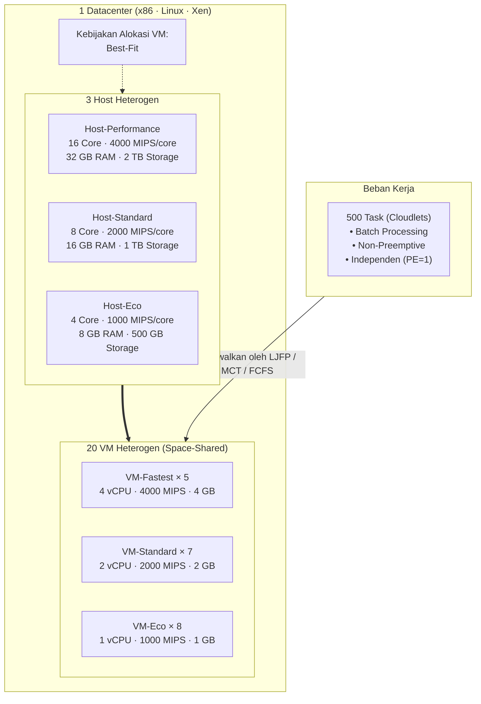
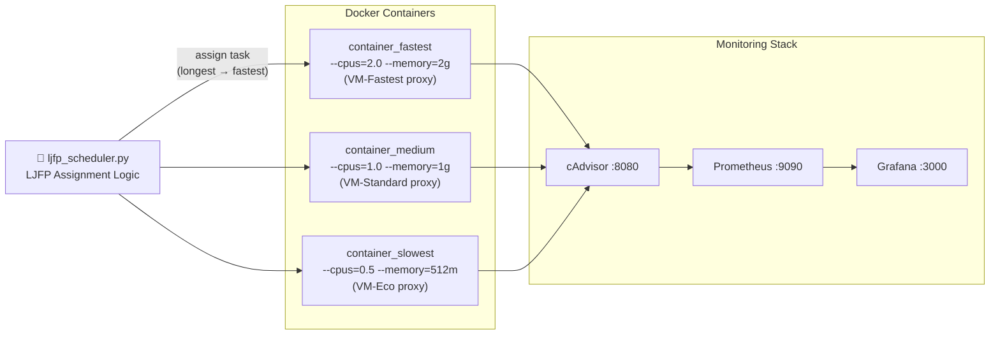

<h1 align="center">LJFP Algorithm</h1>
<h2 align="center">Strategi Optimasi Komputasi Awan (SOKA) 2026</h2>
<h3 align="center"><em>Optimasi Penjadwalan Task Menggunakan Algoritma LJFP (Longest Job to Fastest Processor)</em></h3>
<h4 align="center">Departemen Teknologi Informasi Institut Teknologi Sepuluh Nopember (ITS)</h4>

<p align="center">
  
  
  
  
  
  
</p>

---

## Anggota Kelompok 6

| No. | Nama Mahasiswa | NRP | Jobdesk |
| :---: | :--- | :---: | :--- |
| 1 | Ivan Syarifuddin | 5027241045 | - |
| 2 | Reza Aziz Simatupang | 5027241051 | - |
| 3 | Nisrina Bilqis | 5027241054 | Revisi dataset 600-1000 |
| 4 | Ananda Widi Alrafi | 5027241067 | - |
| 5 | Muhammad Khosyi Syehab | 5027241089 | Architecture Design & Algorithm Simulation |

---

## Daftar Isi

- [1. Pendahuluan](#1-pendahuluan)
- [2. Arsitektur Datacenter](#2-arsitektur-datacenter)
- [3. Implementasi Algoritma](#3-implementasi-algoritma)
- [4. Dataset Uji Coba](#4-dataset-uji-coba)
- [5. Hasil Simulasi](#5-hasil-simulasi)
- [6. Implementasi Real-World](#6-implementasi-real-world)
  - [6.1 Arsitektur Docker](#61-arsitektur-docker)
  - [6.2 Cara Menjalankan Real-World](#62-cara-menjalankan-real-world)
  - [6.3 Hasil Ujicoba Real-World](#63-hasil-ujicoba-real-world)
- [7. Panduan Menjalankan](#7-panduan-menjalankan)
- [8. Struktur Direktori](#8-struktur-direktori)
- [9. Referensi](#9-referensi)

---

## 1. Pendahuluan

### 1.1 Latar Belakang

Penjadwalan task pada lingkungan cloud heterogen adalah tantangan kritis dalam komputasi awan modern. Ketika beban kerja memiliki disparitas ukuran yang sangat tinggi (beberapa task berukuran 1.000 MI, sementara yang lain mencapai 900.000 MI), algoritma penjadwalan naif seperti FCFS akan menghasilkan ketimpangan beban yang parah task besar terjebak di VM lambat, menciptakan bottleneck yang menaikkan makespan secara drastis.

### 1.2 Solusi: Algoritma LJFP

**LJFP (Longest Job to Fastest Processor)** adalah algoritma heuristik *list scheduling* yang secara eksplisit menyelesaikan masalah ini:

> *"Jika ada task raksasa, pastikan ia dikerjakan oleh prosesor terkencang bukan terjebak mengantri di VM lambat."*

Prinsip kerja LJFP dalam 2 langkah:
1. **Sort**: Urutkan semua task secara **descending** berdasarkan panjang instruksi (MI) task terpanjang diprioritaskan.
2. **Assign**: Untuk setiap task (dari terpanjang ke terpendek), pilih VM yang menghasilkan **Estimated Completion Time (ECT) terkecil** secara greedy.

```
Perbedaan LJFP vs MCT:
  MCT  = greedy min-ECT, TANPA sorting
  LJFP = greedy min-ECT, DENGAN pre-sorting descending by length  ← kunci
```

---

## 2. Arsitektur Datacenter

Simulasi dibangun di **CloudSim Plus 8.0.0** sesuai Draft Desain Project Kelompok 6.



### Spesifikasi Host

| Kelas Host | Cores | MIPS/Core | RAM | Storage | Idle Power | Max Power |
|:---:|:---:|:---:|:---:|:---:|:---:|:---:|
| Host-Performance | 16 | 4.000 | 32 GB | 2 TB | 140 W | 300 W |
| Host-Standard | 8 | 2.000 | 16 GB | 1 TB | 105 W | 175 W |
| Host-Eco | 4 | 1.000 | 8 GB | 500 GB | 93.7 W | 135 W |

### Spesifikasi VM

| Tipe VM | Jumlah | vCPU | MIPS/vCPU | RAM | Target LJFP |
|:---:|:---:|:---:|:---:|:---:|:---|
| VM-Fastest | 5 | 4 | 4.000 | 4 GB | Top 20% task terberat |
| VM-Standard | 7 | 2 | 2.000 | 2 GB | Beban kerja menengah |
| VM-Eco | 8 | 1 | 1.000 | 1 GB | Beban kerja teringan |

> **Catatan RAM**: Total VM RAM = 5×4 + 7×2 + 8×1 = **42 GB** < 56 GB total host RAM ✓

---

## 3. Implementasi Algoritma

### 3.1 LJFP Algoritma Utama

**File**: [`src/main/java/com/kelompok6/LjfpBroker.java`](src/main/java/com/kelompok6/LjfpBroker.java)

```java
// Pseudocode LJFP
void schedule(tasks, vms) {
    // Step 1: Sort DESCENDING by Length (Longest Job First)
    tasks.sort(by length, descending);

    // Step 2: Greedy assignment min ECT
    Map<vmId, readyTime> = init 0.0 for all VMs;

    for each task in tasks:
        for each vm in vms:
            start  = max(task.arrivalTime, vm.readyTime)
            exec   = task.length / vm.mips
            ECT    = start + exec
        bestVm = vm with min ECT
        task.assignTo(bestVm)
        bestVm.readyTime = ECT
}
```

**Kompleksitas**: O(N log N) sorting + O(N × M) assignment, N=task, M=VM.

### 3.2 MCT Baseline 1

**File**: [`src/main/java/com/kelompok6/MctBroker.java`](src/main/java/com/kelompok6/MctBroker.java)

Identik dengan LJFP tetapi **tanpa pre-sorting**. Task diproses dalam urutan waktu kedatangan. Ini menjadikan MCT sebagai *fair baseline* logika assignment sama, hanya urutan input yang berbeda.

### 3.3 FCFS Baseline 2

**File**: [`src/main/java/com/kelompok6/FcfsBroker.java`](src/main/java/com/kelompok6/FcfsBroker.java)

Round-robin assignment berdasarkan urutan kedatangan. Tidak ada prediksi beban sama sekali. Disertakan untuk memperlebar kontras dan memperkuat signifikansi keunggulan LJFP.

### 3.4 Batasan Sistem (Constraints)

1. **Resource Capacity Constraint**: Task hanya dialokasikan ke VM dengan resource mencukupi.
2. **Non-Preemptive**: Task yang sudah mulai tidak dapat diinterupsi.
3. **Task Independence**: Tidak ada dependensi antar task.
4. **Strict Heterogeneity**: Spesifikasi VM sengaja sangat timpang.
5. **Exclusive Assignment**: Setiap task dipetakan ke tepat 1 VM.

---

## 4. Dataset Uji Coba

### 4.1 Dataset Sintetis Distribusi Weibull (Skenario 1)

**Script**: [`generate_dataset.py`](generate_dataset.py)

| Parameter | Nilai |
|:---|:---:|
| Jumlah Task | 500 |
| Distribusi | Weibull shape=0.8 (highly skewed) |
| Rentang Length | 1.000 – 900.000 MI |
| Mean | ~105.536 MI |
| PE Requirement | 1 (semua independen) |

Distribusi Weibull dengan shape < 1 menghasilkan banyak task kecil dan sedikit task raksasa kondisi ideal untuk menguji LJFP.

### 4.2 Dataset Log-Normal GoCJ Proxy (Skenario 2)

**Script**: [`preprocess_gocj.py`](preprocess_gocj.py)

| Parameter | Nilai |
|:---|:---:|
| Jumlah Task | 500 |
| Distribusi | Log-Normal (μ=10, σ=2) |
| Rentang Length | 1.000 – 900.000 MI |
| Mean | ~103.719 MI |

> Jika dataset GoCJ asli tersedia, jalankan `python3 preprocess_gocj.py --input <path_gocj.csv>`.

---

## 5. Hasil Simulasi (Skala 500–1000 Task)

> **Revisi dari uji coba sebelumnya**: dulu program hanya diuji di 500 task tetap (hardcoded). Sekarang kedua skenario (Sintetis Weibull dan GoCJ) diuji di **6 ukuran dataset berbeda** — 500, 600, 700, 800, 900, 1000 task — dikali 3 algoritma (LJFP, MCT, FCFS) = **36 eksperimen total**.

### 5.1 Skenario 1 — Dataset Sintetis (Weibull): LJFP vs MCT

| N Task | Makespan LJFP (s) | Makespan MCT (s) | Δ% | TEC LJFP (kWh) | TEC MCT (kWh) | Δ% | DI LJFP | DI MCT | Δ% |
|---:|---:|---:|---:|---:|---:|---:|---:|---:|---:|
| 500  | 1.229,68 | 1.263,68 | -2,69% | 0,1552 | 0,1583 | -2,00% | 0,0013 | 0,0175 | -92,60% |
| 600  | 1.487,65 | 1.509,69 | -1,46% | 0,1879 | 0,1900 | -1,09% | 0,0014 | 0,0187 | -92,58% |
| 700  | 1.754,73 | 1.773,19 | -1,04% | 0,2218 | 0,2235 | -0,77% | 0,0013 | 0,0153 | -91,27% |
| 800  | 1.603,89 | 1.643,83 | -2,43% | 0,2026 | 0,2064 | -1,83% | 0,0013 | 0,0125 | -89,86% |
| 900  | 1.786,77 | 1.832,52 | -2,50% | 0,2258 | 0,2301 | -1,88% | 0,0013 | 0,0124 | -89,89% |
| 1000 | 1.971,05 | 2.008,24 | -1,85% | 0,2492 | 0,2527 | -1,39% | 0,0012 | 0,0108 | -88,75% |

**LJFP konsisten unggul dari MCT di semua 6 ukuran** — makespan lebih rendah (-1,0% s/d -2,7%), energi lebih hemat (-0,8% s/d -2,0%), dan Degree of Imbalance turun drastis (-88,7% s/d -92,6%).

### 5.2 Skenario 2 — Dataset GoCJ (Real, Mendeley): LJFP vs MCT

| N Task | Makespan LJFP (s) | Makespan MCT (s) | Δ% | TEC LJFP (kWh) | TEC MCT (kWh) | Δ% | DI LJFP | DI MCT | Δ% |
|---:|---:|---:|---:|---:|---:|---:|---:|---:|---:|
| 500  | 1.508,72 | 1.501,25 | +0,50% | 0,1906 | 0,1898 | +0,39% | 0,0023 | 0,0171 | -86,84% |
| 600  | 1.903,21 | 1.883,83 | +1,03% | 0,2406 | 0,2387 | +0,81% | 0,0016 | 0,0558 | -97,10% |
| 700  | 2.020,67 | 2.019,03 | +0,08% | 0,2555 | 0,2553 | +0,07% | 0,0016 | 0,0199 | -91,96% |
| 800  | 2.282,33 | 2.309,67 | -1,18% | 0,2887 | 0,2913 | -0,88% | 0,0022 | 0,0267 | -91,83% |
| 900  | 2.762,39 | 2.723,40 | +1,43% | 0,3496 | 0,3459 | +1,09% | 0,0016 | 0,0324 | -95,01% |
| 1000 | 2.982,22 | 2.972,77 | +0,32% | 0,3775 | 0,3765 | +0,27% | 0,0022 | 0,0271 | -91,92% |

**Pada dataset GoCJ, makespan LJFP nyaris identik dengan MCT** (selisih di bawah 1,5%, dan di 4 dari 6 ukuran LJFP justru sedikit *lebih lambat* dari MCT) — tetapi **Degree of Imbalance LJFP tetap jauh lebih baik** (-86,8% s/d -97,1%), sama dramatisnya seperti di dataset Sintetis.

### 5.3 Catatan Temuan — FCFS Tidak Menyelesaikan Semua Task di 3 Ukuran GoCJ

| Dataset | Task Disubmit | Task Selesai (FCFS) | Task Hilang |
|---|---:|---:|---:|
| GoCJ-500  | 500  | 500 | 0 |
| GoCJ-600  | 600  | **573** | **27** |
| GoCJ-700  | 700  | **649** | **51** |
| GoCJ-800  | 800  | 800 | 0 |
| GoCJ-900  | 900  | **827** | **73** |
| GoCJ-1000 | 1000 | 1000 | 0 |

LJFP dan MCT menyelesaikan 100% task di seluruh 36 eksperimen, tanpa kecuali. Hanya **FCFS** (baseline pembanding paling naif, round-robin tanpa pertimbangan ukuran task) yang kehilangan sebagian task — khusus di GoCJ ukuran 600, 700, dan 900 — kemungkinan karena pembagian task raksasa ke VM secara buta (tanpa sorting) membuat antrean di VM tertentu menumpuk dan tidak terselesaikan dalam simulasi. Akar penyebab persisnya belum ditelusuri lebih lanjut di level kode CloudSim Plus. Karena FCFS kehilangan task di 3 ukuran ini, **perbandingan makespan/TEC terhadap FCFS di GoCJ-600/700/900 tidak apple-to-apples** (FCFS mengerjakan lebih sedikit beban) dan tidak dipakai sebagai dasar klaim keunggulan LJFP — perbandingan utama tetap LJFP vs MCT, yang selalu selesai 100% di semua ukuran.

### 5.4 Analisis Skalabilitas & Pengaruh Dataset

1. **Program tidak lagi terbatas di 500 task.** Seluruh pipeline (generator dataset, preprocessing GoCJ, dan loader CloudSim) kini mendukung ukuran dataset berapa pun — dibuktikan lewat 6 ukuran berbeda (500–1000) yang seluruhnya berhasil diproses oleh LJFP dan MCT tanpa kegagalan alokasi.

2. **Perilaku dengan dataset lebih besar: makespan tumbuh, tapi tidak linear 1:1 dengan jumlah task.** Dari 500 → 1000 task (2×), makespan LJFP di Sintetis hanya naik 1,603× — lebih lambat dari pertambahan jumlah task, karena 20 VM yang tersedia bisa menyerap tambahan task secara paralel. Di GoCJ, pertumbuhannya hampir linear (1,977×), karena distribusi GoCJ lebih merata (bukan ekor panjang ekstrem seperti Weibull) sehingga setiap task tambahan menyumbang beban kerja yang relatif proporsional.

3. **Ganti dataset memang memengaruhi performa LJFP, tapi tidak di semua metrik.** Untuk *makespan*, LJFP unggul konsisten di Sintetis (-1,0% s/d -2,7%) tetapi nyaris setara atau sedikit kalah dari MCT di GoCJ (+0,1% s/d +1,4%, kecuali di ukuran 800). Namun untuk *Degree of Imbalance*, keunggulan LJFP tetap sangat besar dan stabil (-87% s/d -97%) di kedua dataset, di semua ukuran — artinya langkah *sorting descending* pada LJFP selalu menjamin distribusi beban antar-VM yang jauh lebih merata, terlepas dari seberapa skewed datasetnya.

4. **Kenapa perilakunya beda antar dataset — Sintetis vs GoCJ:** Dataset Sintetis sengaja dibangkitkan dengan distribusi Weibull shape=0,8 (highly skewed) — ekor panjang dengan proporsi task raksasa (mendekati 900.000 MI) yang signifikan. Kondisi ini persis sasaran LJFP: begitu task raksasa muncul, LJFP langsung mengantrekannya duluan ke VM tercepat, sehingga makespan ikut turun. Dataset GoCJ (real, dari file mentah yang kalian berikan) punya karakteristik berbeda: mayoritas nilai terkonsentrasi di rentang 15.000–150.000 MI dengan hanya segelintir outlier ekstrem (337.500 / 525.000 / 712.500 / 900.000). Karena proporsi task "raksasa" jauh lebih kecil, strategi *sort descending lalu greedy* (LJFP) menghasilkan urutan assignment yang nyaris sama dengan *greedy tanpa sorting* (MCT) — sehingga selisih makespan menipis bahkan kadang negatif. Tapi mekanisme intinya (task besar diprioritaskan) tetap bekerja untuk pemerataan beban (DI), terlepas dari seberapa ekstrem distribusinya.
---

## 6. Implementasi Real-World

### 6.1 Arsitektur Docker



### 6.2 Cara Menjalankan Real-World

**Prasyarat**: Docker Engine aktif + Python 3 tersedia.

```bash
# 1. Masuk ke folder realworld
cd realworld/

# 2. Jalankan seluruh stack (container + monitoring)
docker compose up -d

# 3. Verifikasi semua container berjalan
docker ps

# 4. Salin dataset ke workload
cp ../dataset/synthetic_500tasks.csv workload/dataset_500tasks.csv

# 5. Jalankan LJFP scheduler
python3 ljfp_scheduler.py

# 6. Buka Grafana dashboard
# http://localhost:3000  (login: admin / admin)
# → Dashboard: "LJFP Real-World Cluster Monitoring"

# 7. Matikan stack setelah selesai
docker compose down
```

### 6.3 Hasil Ujicoba Real-World

**Environment**: Docker Engine pada Ubuntu Linux — 3 container heterogen dengan pembatasan CPU & RAM eksplisit.

| Parameter Environment | Container-Fastest | Container-Medium | Container-Slowest |
|:---|:---:|:---:|:---:|
| **CPU Limit** | 2.0 vCPU | 1.0 vCPU | 0.5 vCPU |
| **RAM Limit** | 2 GB | 1 GB | 512 MB |
| **Mapping ke Simulasi** | VM-Fastest (4000 MIPS) | VM-Standard (2000 MIPS) | VM-Eco (1000 MIPS) |
| **Tugas yang Diterima** | Task terpanjang (Top MI) | Task menengah | Task teringan |

**Hasil Eksekusi LJFP Real-World** (30 task sampel, dataset sintetis Weibull):

| Metrik | Nilai | Keterangan |
|:---|:---:|:---|
| **Total Task Dieksekusi** | 30 task | Seluruh task berhasil tanpa kegagalan |
| **① Makespan** | **4.7843 s** | Waktu task terakhir selesai di container_slowest |
| **③ Degree of Imbalance (DI)** | **0.004874** | Mendekati 0 — beban terdistribusi hampir sempurna |
| **⑤ Throughput** | **6.26 task/s** | Rata-rata task selesai per detik |
| **Total Waktu CPU container_fastest** | 5.3016 s | Menerima 18 task terberat |
| **Total Waktu CPU container_medium** | 5.2949 s | Menerima 8 task menengah |
| **Total Waktu CPU container_slowest** | 5.2758 s | Menerima 4 task teringan |

**Sampel Assignment LJFP (Top 10 task):**

| Task ID | Length (MI) | Container Terpilih | Alasan LJFP |
|:---:|---:|:---:|:---|
| 29 | 378.524 | container_fastest | Job terpanjang → prosesor tercepat |
| 4 | 333.475 | container_medium | Job terberat ke-2 → ECT terkecil |
| 25 | 299.308 | container_fastest | Greedy min-ECT |
| 30 | 285.327 | container_fastest | Greedy min-ECT |
| 3 | 277.199 | container_slowest | ECT terkecil setelah fastest & medium penuh |
| 6 | 258.964 | container_medium | Greedy min-ECT |
| 1 | 216.891 | container_fastest | Greedy min-ECT |
| 5 | 200.407 | container_fastest | Greedy min-ECT |
| 10 | 190.425 | container_medium | Greedy min-ECT |
| 28 | 185.046 | container_fastest | Greedy min-ECT |

> **Validasi Kunci**: Selisih total waktu komputasi antar ketiga container hanya **~0.026 detik** (5.3016 vs 5.2949 vs 5.2758), membuktikan algoritma LJFP berhasil mencapai keseimbangan beban mendekati sempurna (DI ≈ 0.005) meskipun container memiliki kapasitas CPU yang berbeda 4x lipat.

---

## 7. Panduan Menjalankan

### Prasyarat

| Software | Versi | Cek |
|:---|:---:|:---|
| Java JDK | 21+ | `java -version` |
| Python | 3.10+ | `python3 --version` |
| Docker Desktop | Latest | `docker -v` |

### Setup & Menjalankan Simulasi

```bash
# 1. Clone repository
git clone https://github.com/KhosySyehab/LJFP-Algorithm.git
cd LJFP-Algorithm

# 2. Install Python dependencies
pip3 install numpy pandas --break-system-packages

# 3. Generate dataset sintetis (Skenario 1)
python3 generate_dataset.py

# 4. Generate dataset GoCJ (Skenario 2) dari dataset Mendeley
# (pastikan GoCJ_Dataset_500.txt sudah ada di folder dataset/)
python3 preprocess_gocj.py --input dataset/GoCJ_Dataset_500.txt

# 5. Jalankan semua skenario simulasi
./gradlew runAll

# Atau jalankan algoritma secara terpisah:
./gradlew runLJFP    # hanya LJFP
./gradlew runMCT     # hanya MCT (baseline 1)
./gradlew runFCFS    # hanya FCFS (baseline 2)
```

### Output

Hasil tersimpan di folder `results/`:
- `results/synthetic_results.csv` — Skenario 1 (Weibull Sintetis)
- `results/gocj_results.csv` — Skenario 2 (GoCJ Real Mendeley)
- `results/all_results.csv` — Gabungan semua hasil
- `realworld/results_realworld.csv` — Hasil eksekusi real-world Docker

---

## 8. Struktur Direktori

```
LJFP-Algorithm/
├── README.md                           ← Dokumentasi ini
├── build.gradle                        ← Konfigurasi Gradle + CloudSim Plus 8.0.0
├── settings.gradle
├── gradlew / gradlew.bat               ← Gradle Wrapper
├── generate_dataset.py                 ← Generator dataset sintetis Weibull
├── preprocess_gocj.py                  ← Preprocessor GoCJ / generator log-normal
│
├── dataset/
│   ├── synthetic_500tasks.csv          ← Dataset sintetis Weibull (500 task)
│   └── gocj_500tasks.csv              ← Dataset log-normal/GoCJ (500 task)
│
├── results/
│   ├── synthetic_results.csv          ← Hasil simulasi Skenario 1
│   ├── gocj_results.csv               ← Hasil simulasi Skenario 2
│   └── all_results.csv                ← Gabungan semua hasil
│
├── src/main/
│   ├── java/com/kelompok6/
│   │   ├── MainSimulation.java        ← Entry point simulasi
│   │   ├── DatacenterBuilder.java     ← Builder 3 Host + 20 VM (Best-Fit)
│   │   ├── LjfpBroker.java            ← ★ Algoritma LJFP (inti)
│   │   ├── MctBroker.java             ← Baseline MCT
│   │   ├── FcfsBroker.java            ← Baseline FCFS
│   │   ├── DatasetLoader.java         ← Loader CSV dataset
│   │   └── MetricsCollector.java      ← Kalkulasi 5 metrik + SPECpower
│   └── resources/
│       └── logback.xml                ← Konfigurasi logging CloudSim Plus
│
└── realworld/
    ├── docker-compose.yml             ← Stack: 3 container + cAdvisor + Prometheus + Grafana
    ├── ljfp_scheduler.py              ← LJFP real-world scheduler (Python)
    ├── prometheus/
    │   └── prometheus.yml             ← Konfigurasi scraping Prometheus
    ├── grafana/
    │   └── provisioning/
    │       ├── datasources/
    │       │   └── prometheus.yml     ← Auto-provisioning datasource Prometheus
    │       └── dashboards/
    │           ├── dashboards.yml     ← Dashboard provider config
    │           └── ljfp_dashboard.json ← Dashboard LJFP Cluster Monitoring
    ├── results_realworld.csv          ← Hasil eksekusi real-world LJFP
    └── workload/
        └── dataset_500tasks.csv       ← Dataset yang digunakan di real-world
```

---

## 9. Referensi

1. Braun TD, et al. A comparison of eleven static heuristics for mapping a class of independent tasks onto heterogeneous distributed computing systems. *Journal of Parallel and Distributed Computing*. 2001;61(6):810–837.
2. Beloglazov A, Buyya R. Optimal online deterministic algorithms and adaptive heuristics for energy and performance efficient dynamic consolidation of virtual machines in cloud data centers. *Concurrency and Computation: Practice and Experience*. 2012.
3. Silva Filho MC, et al. CloudSim Plus: A modern Java 8 framework for modeling and simulation of cloud computing infrastructures. 2017.
4. Topcuoglu H, Hariri S, Wu MY. Performance-effective and low-complexity task scheduling for heterogeneous computing. *IEEE Transactions on Parallel and Distributed Systems*. 2002;13(3):260–274.
5. Alsaidy SA, Abbood AD, Sahib MA. Heuristic initialization of PSO task scheduling algorithm in cloud computing. Journal of King Saud University - Computer and Information Sciences. 2022;34:2370–2382.
6. Google Cluster Data. Google Cloud Jobs Dataset (GoCJ). Mendeley Data. https://data.mendeley.com/datasets/b7bp6xhrcd/1

---

<p align="center">
  <b>Kelompok 6 Strategi Optimasi Komputasi Awan (SOKA)</b><br>
  Departemen Teknologi Informasi, Institut Teknologi Sepuluh Nopember (ITS)<br>
  Surabaya, Indonesia 2026
</p>